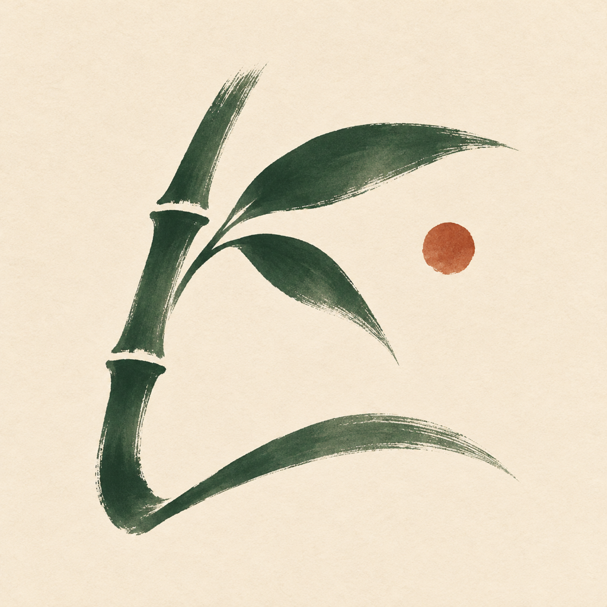
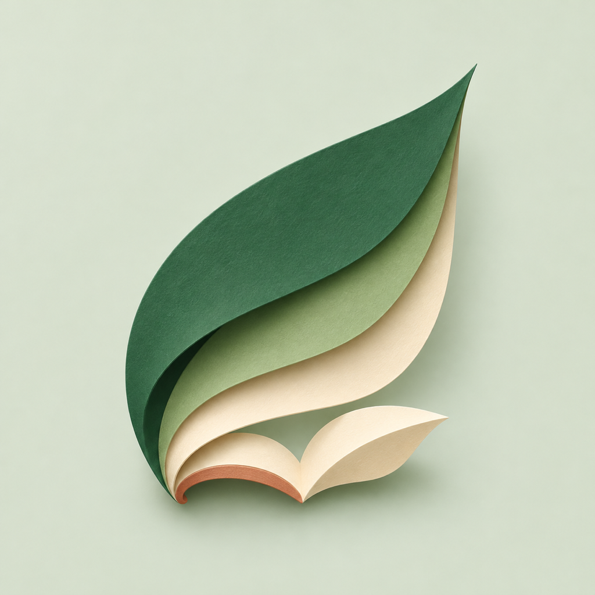

# 竹影图标备选

三款图标通过内置 ImageGen 分别生成，均导出为 1024 × 1024、不透明 RGB PNG。三款为备选设计；当前 iOS AppIcon 仍使用首版图标。

| 水墨留白 | 现代几何 | 立体纸雕 |
| --- | --- | --- |
|  |  |  |
| 米白纸面、墨绿竹叶与朱砂点，侧重东方书卷气。 | 鲜明玉绿、米白几何与折页负形，侧重清晰辨识。 | 浅鼠尾草绿、多层折纸与柔和阴影，侧重温暖质感。 |

原始提示词逐款保存在 [variants.json](variants.json)，可用于后续迭代。设计沿用竹影的阅读与竹叶意象，并通过笔触、几何构成和纸材层次区分风格。

图像导出仅规范化尺寸与 RGB 格式，不改变生成构图。图片保留完整正方形底色，应用圆角由 iOS 遮罩。

运行 `npm run check` 和 `npm test` 验证。图标测试覆盖清单引用、1024 × 1024 尺寸、可解码的不透明 RGB PNG 和三份内容互不重复。
