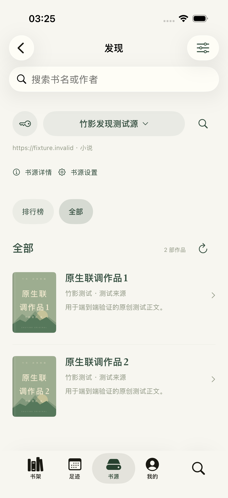

# 竹影阅读、书源与丰富发现回归

本轮在已提交的阅读 3.0 兼容基线上处理用户提出的八项问题，沿用原页面、主题组件及详情／阅读导航。未改动另一工作区正在进行的发布任务。

| 项目 | 最终行为 |
| --- | --- |
| 正文及目录缓存 | 正文右上角提供刷新正文、清除缓存；目录右上角提供当前书临时正文缓存清理。刷新直接请求书源，保留锚点，失败保留旧正文。持久下载和阅读记录保留。 |
| 书源快捷操作 | 右滑显示登录、刷新书源、浏览器打开；原左滑编辑与长按入口保留。刷新重建选中来源的规则运行环境，保留登录和导入配置。 |
| 详情登录 | 自定义来源详情统一提供登录，进入对应来源的实际登录表单或浏览器。 |
| 登录反馈 | 反馈悬浮在视口顶部，五秒后消失，可关闭；不随表单滚动到底部。 |
| 检测当前服务器 | 原版规则已声明或用户手动允许的 HTTP(S) 线路均可请求；协议、端口、账号及资料库隔离，Secure Cookie 不发往 HTTP。 |
| 作品详情 | 右上角刷新实际详情与目录，书架操作保留在原底部位置。 |
| 精准搜索 | 开关按规范化后的完整书名或作者匹配，后续分页继续过滤，保留关闭开关恢复广泛结果的路径。 |
| 丰富发现 | 书源 Tab 的更多菜单可进入发现页，发现页右上角切换丰富模式。支持来源切换、登录、静态／动态分类、分页、封面、作者、简介及原详情阅读路径，简洁模式仍可选。 |

HTTP 支持系统网络和 HTTP CONNECT 代理；指定 IP／DNS 配置仅适用于 HTTPS，界面及保存验证均按协议限制。应用 ATS 例外允许已导入书源产生的 HTTP 请求；其余服务继续使用原有 URL 校验。跨主机自动重定向不放宽，普通临时浏览仍默认只接受 HTTPS。

新增或扩展的回归覆盖：`LegadoHTTPCompatibilityTests`、`SourceBookCoverTests`、`SourceNetworkTests`、`SourceQuickActionsTests`、`DiscoveryAndSearchTests`、`OnlineReadingTests`、`ReadingSessionControllerTests`，以及 `DiscoveryFlowTests`、`LegadoLoginFlowTests`、`OnlineReadingFlowTests` 三组界面流程。HTTP 原生请求另外使用本机临时 TCP 服务验证真实 URLSession 连通；书籍、分类和登录测试均为原创夹具，不冒充用户真实服务验收。

| 检查 | 结果 |
| --- | --- |
| iOS 全量单元测试 | 650 / 650，通过 |
| 相关 UI 回归 | 6 个不同用例均通过，分批验证 |
| Web 测试及语法检查 | 106 / 106，检查通过 |
| iPhone SE 小屏复测 | 2 / 2，通过（375 点宽度） |
| Production Release，iOS arm64 | BUILD SUCCEEDED，未签名设备构建 |

650 项单元测试及最终两个界面用例见 `/tmp/zhuying-eight-fixes-completion-tests.log`。精准搜索、丰富发现、登录表单及缓存界面通过记录在 `/tmp/zhuying-eight-fixes-final-tests.log`；该轮同时记录了后来修复并重新验证的普通 Cookie、右滑按钮样式和目录点击范围问题，没有将失败记录当作整轮通过。小屏、最终 Web 和 Release 日志分别为 `small-screen`、`web-verified`、`release-verified` 后缀。

丰富模式的模拟器截图使用原创测试来源，不含用户来源资料：

本机日志保存在 `/tmp/zhuying-eight-fixes-*.log`；不包含用户真实来源配置或登录凭据。界面验证使用独立模拟器“竹影功能回归”，未操作用户现有的书源实测模拟器。
