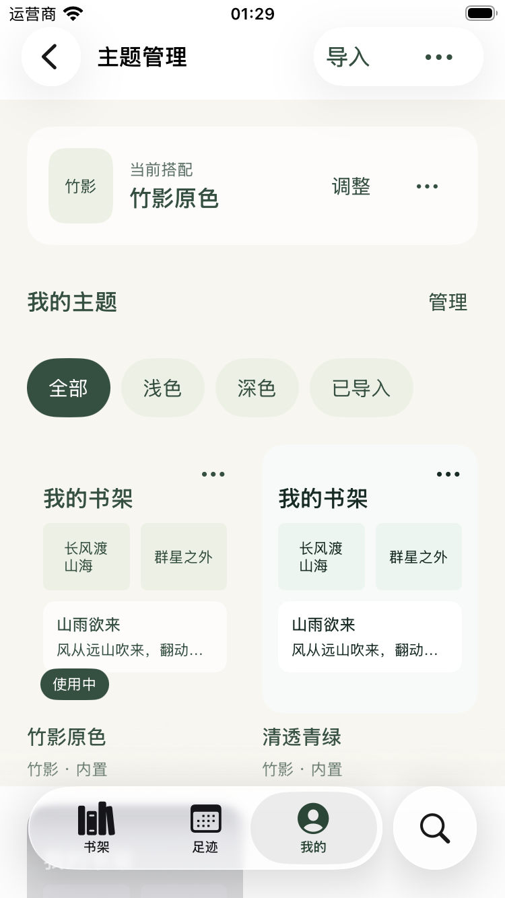
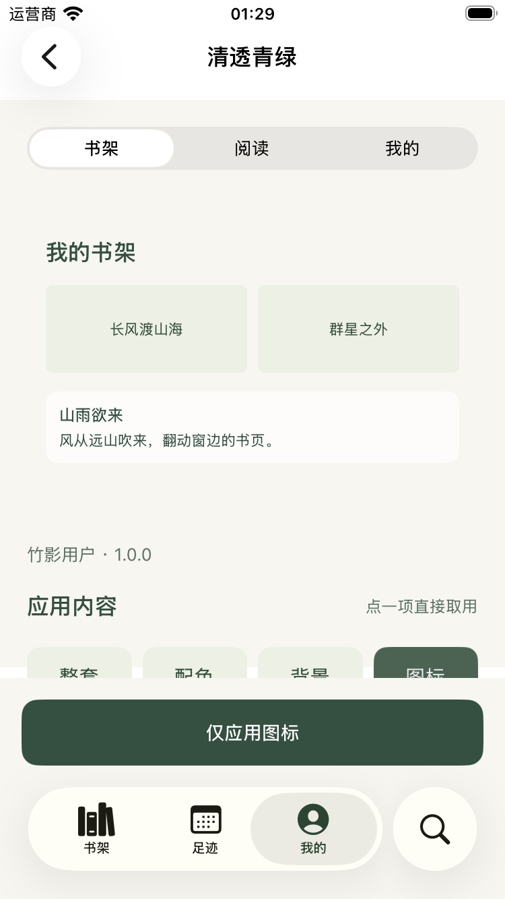

# 竹影封面主题库实装

本次按确认的封面主题库方案更新原生主题管理。正式模式和当前原生 Demo 共用实现。

## 页面与操作

- 主题管理首页显示当前搭配、浅深色筛选和双列封面库；辅助功能大字号采用单列。
- 封面上的更多按钮仅显示三个点，背景透明，保留 44 × 44 pt 点击区域。点封面进入预览；长按使用系统上下文菜单，更多按钮显示同一组操作。
- 任意主题均可直接分享原包、另存副本或进入多选，无需先应用。导入主题分享原始字节，保留素材、作者和许可；内置主题可分享、复制，不能删除。
- 管理在首页切换为多选，支持筛选、全选、批量分享和批量删除。删除已用主题会说明受影响的部分，确认后只重置对应外观；相关恢复点一并清除。
- 当前搭配的调整、快照分享、保存新主题与恢复集中在当前搭配区域。调整页复用现有配色、素材、字体、排版、页眉页脚、CSS 标题和段评编辑器。
- 预览直接选择整套、配色、背景、图标、排版、标题、气泡，或在多选中组合这些内容及段评。单个应用按钮随所选范围改变；其余部分继承当前搭配，翻页方式与震动保留。
- 原阅读搭配、独立 CSS 标题和 SVG 气泡库由右上角“更多主题工具 → 阅读搭配与独立样式”进入。主导航仍为书架、足迹、我的、搜索。

## 存储与导出

新增可选的分项主题来源映射，同时兼容原 appID / readerID 选择记录。各部分混搭来源与恢复点随生产书库保存、备份和恢复。

界面配色、背景、图标分别组装；不同来源的同名资源按内容哈希重命名，避免混搭时互相覆盖。导出的当前搭配包含实际生效的阅读 CSS、气泡、段评、阅读背景、字体及已有分发许可。字体许可仅能从文件内容相同的原主题字体继承。

删除先写临时目录索引、保存对应外观，再替换正式索引；失败时恢复外观，保留原主题文件。中途退出不会先移除仍被旧设置引用的主题。

## 验证

- 原生单元测试：418 项，全部通过，包含各部分独立应用、混搭持久化与恢复、同名资源隔离、原包分享、字体许可继承、删除失败回滚和混搭备份完整性。
- Node 测试：89 项全部通过；`npm run check` 通过。
- UI 回归覆盖 14 个独立场景：主题应用与重启恢复、原包分享、同页批量管理、气泡单独取用与删除、主题制作、AI 资料导出、真实孤舟浅深色主题导入及书架/阅读渲染、原独立样式库、生产阅读设置持久化、辅助大字号与横屏。
- 常规 iPhone（402 pt）整组回归发现长按留白区域未响应；增加整张封面的 `contentShape` 后，常规屏幕轻点、长按、分享/批量管理的针对性复核 3/3 通过。其余场景在整组回归中通过。
- iPhone SE 3（375 pt），启用减少动态效果：最终小屏封面布局、最大辅助字号/横屏、长按场景 3/3 通过。可滚动查看完整主题库；主按钮位于底部安全区域内。
- iPhoneOS Release 构建通过，使用 `CODE_SIGNING_ALLOWED=NO`。
- 本次交互验证使用模拟器；未将其标记为实体设备验收。

结果保留在本机：

- `/tmp/zhuying-theme-library-verified-unit.xcresult`：最终完整单元测试。
- `/tmp/zhuying-theme-library-final.xcresult`：整组 UI 回归及初始长按问题证据。
- `/tmp/zhuying-theme-library-gesture.xcresult`：修复后的常规屏幕轻点、长按及分享复核。
- `/tmp/zhuying-theme-library-layout.xcresult`：最终小屏布局、大字号/横屏及长按复核。
- `/tmp/zhuying-theme-library-final-node.log`、`/tmp/zhuying-theme-library-final-check.log`。
- `/tmp/zhuying-theme-library-release.log`：iPhoneOS Release 构建。

实际运行截图：

