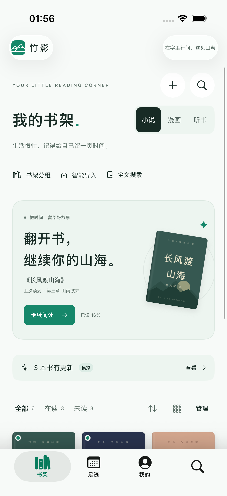
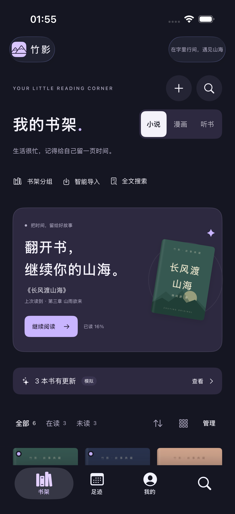

# 竹影主题顶部与底部外观修复

## 问题与修改

页面使用主题色后，顶部导航栏仍可能采用系统自动背景，底部标签栏没有配置主题外观；原页面背景也未统一覆盖状态栏和底部安全区，造成上下两端与主题内容脱节。

- 页面、导航容器和根容器的主题背景覆盖安全区，避免浮动栏下面露出系统白底。
- 顶部与底部栏显式使用当前主题的背景和深浅色模式。书架、搜索、作品详情和历史页一并接入统一页面样式，覆盖原来绕过此样式的页面。
- 原生导航栏的标准、滚动边缘、横屏紧凑和紧凑滚动边缘外观统一应用主题色。
- 底部标签栏及每个标签的普通、选中、禁用状态，及堆叠、横排、紧凑布局接入主题色。底部原生容器铺设主题底色，避免滚动中的书籍封面颜色透入浮动栏和主屏幕指示条区域。
- 每次主题更新重新配置当前原生控制器，避免仅按主题 ID 或文字颜色缓存而遗漏背景变化。
- 继续使用原生导航、返回手势、浮动标签栏和搜索标签；主题预览不修改全局外观。

## 验证

- 全部原生单元测试 420 项通过，新增导航栏和标签栏全部布局的配色、切换主题及保留标题字体的回归。
- Node 测试 89 项通过，`npm run check` 通过。
- UI 验证竹影原色、幻想夜航、清透青绿，检查页面顶部背景及底部安全区颜色，覆盖主题切换、返回、书架、滚动和主标签切换。底部像素检查允许原生浮动栏阴影造成的亮度变化，同时要求保留主题的颜色比例。
- 主题切换、重新启动和恢复上一主题的既有 UI 场景通过。
- 最大辅助字号与横屏管理验证；额外使用 375 pt 的 iPhone SE 3 模拟器复核，减少动态效果设置保留。

搜索聚焦时系统会收起导航栏及其他标签，测试在可见栏位上检查颜色，并通过原生关闭搜索操作返回。

初期整组检查找出了书架绕过统一样式和底部封面颜色透入的问题，修复后重新执行验收；早期诊断记录保留在本机。

本次使用模拟器验证，未将结果标记为实体设备验收。

结果记录：

- `/tmp/zhuying-theme-bars-final-checks.xcresult`：最终 420 项单元测试及小屏复核。
- `/tmp/zhuying-theme-native-bars.xcresult`：主题应用、重启及恢复场景。
- `/tmp/zhuying-theme-bars-verified-flow.xcresult`：最终原色、浅深主题、书架、搜索及滚动验证。
- `/tmp/zhuying-theme-bars-node.log`、`/tmp/zhuying-theme-bars-check.log`。

实际运行截图：

